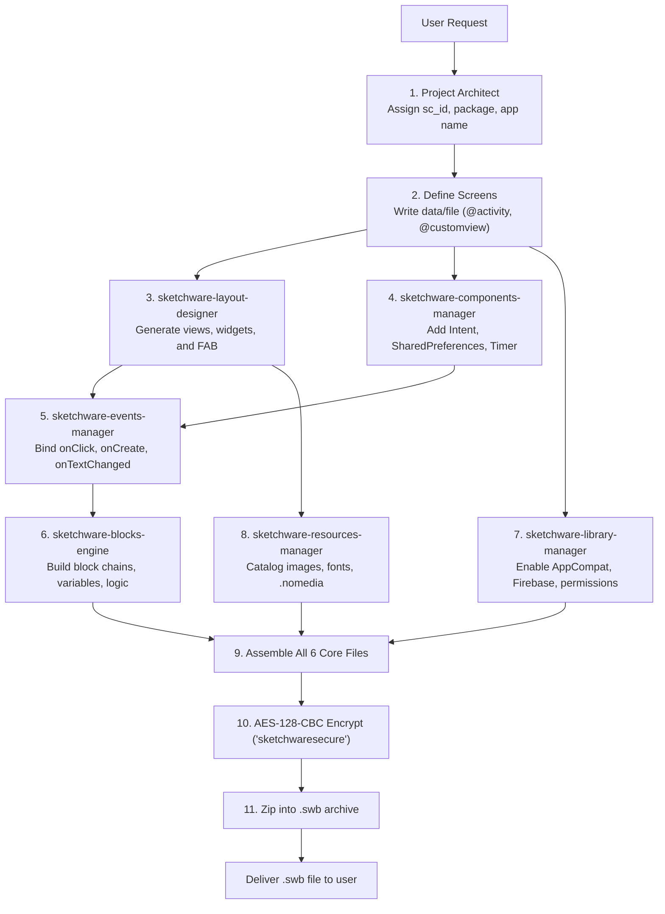

# Sketchware Project Generator (Master Orchestrator)

## Overview
This is the master architect skill for generating complete, production-ready Sketchware Pro projects. It directs and unifies a modular suite of 7 specialized skills to construct valid, 1-click importable `.swb` (Sketchware Backup) files.

### The Specialized Sketchware Skill Suite
| Skill | Primary Responsibility |
|---|---|
| **`sketchware-project-generator`** (This Skill) | Master orchestration, project metadata, screen index, AES encryption, and `.swb` zip packaging |
| **`sketchware-layout-designer`** | UI hierarchy, ViewBean generation, responsive layout params, styling, and FAB configuration |
| **`sketchware-blocks-engine`** | Visual block logic, opcode validation, block chaining (`nextBlock`/`subStack`), variables, lists, and MoreBlocks |
| **`sketchware-events-manager`** | Event declaration (`_events`), activity lifecycle routing, view interaction listeners, and component callbacks |
| **`sketchware-components-manager`** | System components (`_components`), Intents, SharedPreferences, Timers, Dialogs, and RequestNetwork |
| **`sketchware-library-manager`** | External SDKs (`data/library`), AppCompat / AndroidX, Firebase credentials, AdMob units, and permissions |
| **`sketchware-resources-manager`** | Static assets (`data/resource`), images, sounds, fonts, app icon, and `.nomedia` placeholders |

---

## 1. Project Metadata (`project` File)

The `project` file in the archive root is an AES-encrypted JSON string defining project configuration:

```json
{
  "sc_id": "2026",
  "my_ws_name": "SmartApp",
  "my_app_name": "Smart App",
  "my_sc_pkg_name": "com.my.smartapp",
  "sc_ver_code": "1",
  "sc_ver_name": "1.0",
  "sketchware_ver": 150,
  "my_sc_reg_dt": "20261031080000",
  "color_primary": -16744532.0,
  "color_primary_dark": -16744532.0,
  "color_accent": -16744532.0,
  "color_control_normal": -16744532.0,
  "color_control_highlight": -4069121.0,
  "custom_icon": false,
  "isIconAdaptive": false
}
```

### Key Field Rules:
- **`sc_id`**: 4-digit project ID string (e.g. `"2026"`, `"1001"`).
- **`my_sc_pkg_name`**: Valid Android package name (e.g. `com.example.app`).
- **`sketchware_ver`**: Minimum `150` for Sketchware Pro compatibility.
- **`my_sc_reg_dt`**: Timestamp string `YYYYMMDDHHmmss`.
- **Colors**: 32-bit signed float/int numbers (e.g. `-16744532.0` for `#FF008DCD`).

---

## 2. Screen & File Index (`data/file`)

In Sketchware, screen files are cataloged in `data/file` (AES-encrypted):

```text
@activity
{"fileName":"main","fileType":0,"keyboardSetting":0,"options":1,"orientation":0,"theme":-1}
{"fileName":"detail","fileType":0,"keyboardSetting":0,"options":0,"orientation":0,"theme":-1}

@customview
{"fileName":"item_card","fileType":1,"keyboardSetting":0,"options":0,"orientation":0,"theme":-1}
```

### File Bean Attributes:
- **`fileName`**: Name without extension (e.g. `"main"` maps to `MainActivity.java` and `main.xml`).
- **`fileType`**: `0` for Activity, `1` for CustomView.
- **`options`**: Bitmask flag:
  - `0`: None
  - `1`: Has FAB (Floating Action Button)
- **`orientation`**: `0` (Both/Sensor), `1` (Portrait), `2` (Landscape).
- **`theme`**: `-1` for Default theme.

---

## 3. End-to-End Orchestration Workflow

When the user requests a new project (e.g. "Create a Notes App with a list, FAB, and save logic"):



---

## 4. Encryption & Packaging Engine (AES-128-CBC)

### Encryption Specification
- **Algorithm**: `AES/CBC/PKCS5Padding` (PKCS#7 in Python/Node).
- **Key**: `sketchwaresecure` (16 bytes UTF-8).
- **IV**: `sketchwaresecure` (16 bytes UTF-8).
- **Format**: Raw binary bytes written directly into ZIP (no Base64).
- **Trim Rule**: Always `.strip()` whitespace/newlines from plaintext before encrypting.

### Archive File Layout (`.swb` / ZIP)
A valid `.swb` backup package MUST contain exactly this structure:
```text
<project_backup>.swb (ZIP)
├── project                       [Encrypted JSON metadata]
├── data/
│   ├── file                      [Encrypted screen catalog]
│   ├── view                      [Encrypted single file combining all @<screen>.xml]
│   ├── logic                     [Encrypted single file combining all events, vars, blocks]
│   ├── library                   [Encrypted library config (@compat, @firebaseDB, etc.)]
│   └── resource                  [Encrypted asset list (@images, @sounds, @fonts)]
└── resources/
    ├── fonts/
    │   └── .nomedia              [0-byte marker file]
    ├── images/
    │   └── .nomedia              [0-byte marker file]
    ├── sounds/
    │   └── .nomedia              [0-byte marker file]
    └── icons/
        └── .nomedia              [0-byte marker file]
```

---

## 5. Automated Python Generator Template

The agent uses this reference script to pack any project generated by the sub-skills:

```python
import os
import zipfile
from Crypto.Cipher import AES
from Crypto.Util.Padding import pad

KEY = b"sketchwaresecure"
IV = b"sketchwaresecure"

def encrypt(data_str: str) -> bytes:
    data_bytes = data_str.strip().encode("utf-8")
    cipher = AES.new(KEY, AES.MODE_CBC, IV)
    return cipher.encrypt(pad(data_bytes, AES.block_size))

def build_swb(project_dict, file_str, view_str, logic_str, library_str, resource_str, out_path):
    with zipfile.ZipFile(out_path, "w", compression=zipfile.ZIP_DEFLATED) as zf:
        zf.writestr("project", encrypt(project_dict))
        zf.writestr("data/file", encrypt(file_str))
        zf.writestr("data/view", encrypt(view_str))
        zf.writestr("data/logic", encrypt(logic_str))
        zf.writestr("data/library", encrypt(library_str))
        zf.writestr("data/resource", encrypt(resource_str))
        
        # Mandatory .nomedia markers
        zf.writestr("resources/fonts/.nomedia", b"")
        zf.writestr("resources/images/.nomedia", b"")
        zf.writestr("resources/sounds/.nomedia", b"")
        zf.writestr("resources/icons/.nomedia", b"")
```

---

## 6. Verification Checklist Before Export
1. [ ] **`project`**: `sc_id`, package name, and app name properly set.
2. [ ] **`data/file`**: All activities (`@activity`) and custom views (`@customview`) registered.
3. [ ] **`data/view`**: Is a **single file** with valid parent IDs (`"root"` or container IDs) and correct sequential `index`.
4. [ ] **`data/logic`**: Is a **single file** with variable declarations (`<type>:<name>`), registered events (`_events`), and block chains.
5. [ ] **`data/library`**: AppCompat `@compat` has `"useYn": "Y"`.
6. [ ] **`data/resource`**: Contains `@images`, `@sounds`, `@fonts` section markers.
7. [ ] **`resources/`**: All empty asset directories contain `.nomedia`.
8. [ ] **Encryption**: Encrypted with AES-128-CBC key/IV `sketchwaresecure`.
